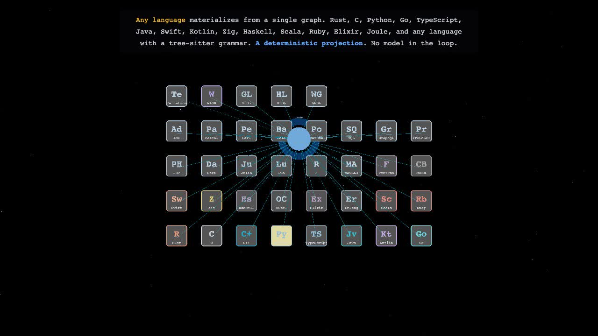

# flow-g

**A typed FunctionGraph IR for heterogeneous inference.**

[](https://github.com/openIE-dev/flow-g/actions/workflows/release.yml)
[](https://github.com/openIE-dev/flow-g/actions/workflows/quality.yml)
[](https://openie-dev.github.io/flow-g)
[](https://crates.io/crates/flowg)
[](./LICENSE)


flowG is the compiler IR + runtime substrate behind the openIE-dev ecosystem. It takes typed function graphs and dispatches them across CPU, Apple-silicon Metal, WGPU, AMX, and the OpDispatch backend family, with picojoule-budgeted per-op energy measurement built in.

This is the **public release surface**. Source is private at [`openIE-dev/flow-g-core`](https://github.com/openIE-dev/flow-g-core): 99 crates spanning the IR, codegen passes, OpDispatch leaves, model runtimes, and benchmarks.

## Watch the film

[](https://flowg-lang.dev/film)

**[The Graph Coding Era](https://flowg-lang.dev/film)** is a 7½-minute narrated visual on a shorter, shared path from intent to silicon. Or read the [interactive explainers](https://flowg-lang.dev/how-it-works): [how it works](https://flowg-lang.dev/how-it-works) · [history](https://flowg-lang.dev/history) · [the math](https://flowg-lang.dev/math).

## Status

> Release binaries + examples + documentation. flowG is **free to use software**, not an open-source project. See [LICENSE](./LICENSE) for the Business Source License 1.1 terms, which convert to Apache-2.0 four years after each binary's release date.

## What you get

| Binary | Purpose |
|---|---|
| `flowg` | The CLI: make-sample, inspect, run (with energy receipts), import PyTorch FX, sign/verify, bench |

The [`flowg`](https://crates.io/crates/flowg) crate on crates.io is an installer stub for `cargo binstall`, not a library.

## Install

Prebuilt binaries are attached to each [GitHub Release](https://github.com/openIE-dev/flow-g/releases).
The fastest way to fetch the right one for your machine is
[`cargo-binstall`](https://github.com/cargo-bins/cargo-binstall):

```bash
cargo install cargo-binstall   # once, if you don't have it
cargo binstall flowg
```

Or download the archive for your platform from the
[latest release](https://github.com/openIE-dev/flow-g/releases/latest)
(`flowg-<version>-<target>.tar.gz`, `.zip` on Windows), unpack it, and put
`flowg-<version>-<target>/flowg` on your `PATH`.

`cargo install flowg` does **not** build flowG: it compiles a small stub that
prints these instructions and exits.

Prebuilt targets:

| Platform | Target |
|---|---|
| macOS arm64 (Apple Silicon) | `aarch64-apple-darwin` |
| Linux x86_64 (glibc 2.39+, e.g. Ubuntu 24.04) | `x86_64-unknown-linux-gnu` |
| Linux aarch64 (glibc 2.39+, e.g. Ubuntu 24.04) | `aarch64-unknown-linux-gnu` |
| Windows x86_64 | `x86_64-pc-windows-msvc` |

The Linux binaries link the system OpenBLAS: install it first
(`sudo apt install libopenblas0` on Debian/Ubuntu).

## Hello, flow-g

```bash
# write a sample graph (a two-input `add`)
flowg make-sample add.fg

# inspect the typed graph: its nodes and resource-semantic wires
flowg inspect add.fg

# run it on two inputs: prints 3.75
flowg run add.fg --input '{"x": 1.5, "y": 2.25}'

# run on the async scheduler and print the energy receipt on stderr
flowg run add.fg --scheduler async --receipt --input '{"x": 1.5, "y": 2.25}'
```

See [`examples/`](./examples/) for runnable programs spanning every backend.

## What makes flow-g different

- **Typed FunctionGraph IR**: not an AST, not a SSA, not a tensor program. Functions are first-class graph nodes with typed signatures, designed for energy-cost-aware dispatch.
- **OpDispatch backend**: kernels are addressed by `(op, dtype, layout, target)` tuples. The runtime picks the lowest-joule kernel that matches.
- **Heterogeneous by default**: CPU + Metal + WGPU + AMX share the same IR. No "GPU port"; just dispatch the same graph at a different target.
- **Energy substrate**: every op has measured picojoule cost on Apple Silicon (IOReport-backed), NVML for Linux NVIDIA, RAPL for x86_64 Linux. Energy receipts are first-class output.
- **70+ model runtimes**: Llama family, Qwen family, Mamba2, Bamba, Jamba, Hunyuan, Gemma 4, LFM2 family, Whisper, Moonshine, V-JEPA, and more, all using the same IR.

## How it fits

flowG is the **substrate**. The openIE-dev language family compiles to it:

- [Lux](https://github.com/openIE-dev/lux-lang): general-purpose reactive language → flowG
- [JMax](https://github.com/openIE-dev/jmax): math-native language → flowG
- [Joule](https://github.com/openIE-dev/joule-lang): energy-aware self-hosted language → flowG

And the substrate is metered by [JouleDB](https://github.com/openIE-dev/jouledb), the energy-metered HDC database that records inference receipts.

## Documentation

- Getting started → <https://openie-dev.github.io/flow-g>
- Examples → [`examples/`](./examples/)
- API reference → <https://docs.rs/flowg>
- Source mirror → [`openIE-dev/flow-g-core`](https://github.com/openIE-dev/flow-g-core)

## Releases

[GitHub Releases](https://github.com/openIE-dev/flow-g/releases): tagged versions with prebuilt binaries for every supported platform, plus a SHA-256 checksums file per release.

## Community

- [Discussions](https://github.com/openIE-dev/flow-g/discussions): Q&A, design discussion
- [Issues](https://github.com/openIE-dev/flow-g/issues): bug reports
- Security: see [SECURITY.md](./SECURITY.md)

## License

- **Binaries**: Business Source License 1.1; see [LICENSE](./LICENSE). Free for non-commercial use, internal use by orgs under $1M revenue, security/academic research. Converts to Apache-2.0 four years after each release.
- **Documentation**: CC-BY-4.0
- **Examples**: Apache-2.0
